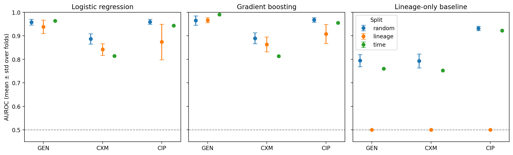

# *E. coli* AMR Generalization

**Does genomic prediction of antibiotic resistance still work on bacterial lineages the model has never seen?**

Related bacterial strains share most of their genes and often their resistance, so a model can score well by recognising a strain's family instead of its resistance genes. Using 1,936 *E. coli* strains from the public PanPred dataset, I trained models to predict lab-tested resistance to three antibiotics and evaluated them with random, lineage-based and time-based train/test splits. When whole lineages were held out, prediction of ciprofloxacin (CIP) resistance, which comes mainly from mutations that the gene data cannot see, dropped clearly (balanced accuracy −0.15), while gentamicin (GEN), whose resistance genes are visible, barely changed. Random splits can therefore overstate how well such models work on new strains, especially when resistance is caused by mutations.

## Question and hypothesis

Random train/test splits usually keep close relatives on both sides, so a model can be tested on strains whose relatives it has already seen. This can make it look better than it really is on genuinely new strains.

**Question:** How well does genomic information predict lab-tested resistance in *E. coli*, and how much of that depends on lineage?

**Hypothesis:** Holding out whole lineages lowers performance more for CIP, whose resistance comes mainly from mutations that the gene table cannot see, than for GEN, whose resistance comes mainly from acquired genes that the gene table can see. CXM, with a mixed mechanism, should fall in between.

## Data

The data comes from the public PanPred dataset ([repository](https://github.com/DaneshMoradigaravand/PanPred)) from the paper Moradigaravand et al. (2018), [*Prediction of antibiotic resistance in Escherichia coli from large-scale pan-genome data*](https://journals.plos.org/ploscompbiol/article?id=10.1371/journal.pcbi.1006258), *PLOS Computational Biology*.

In total, 1,936 strains have lab results; 97 genomes without lab results were dropped. Most strains (1,593) were collected between 2001–2012, 11 are from before 2000, 58 do not have year information, and the remaining 274 are from 2013–2017.

### Files used

| File | Contains | Used for |
| -------- | ------- | -------- |
| `Metadata.csv` | Year and R/S data for each strain for 12 antibiotics | R/S markings are used for labels and year for the time split |
| `AccessoryGene.csv` | Presence/absence of accessory genes (not mutations): 16,933 after removing 265 genes that are present in all or no strains | Model input |
| `PopulationStructure.csv` | Lineage clusters at 1,071 SNP cutoffs | Lineage split |
| `ResFinder_resistance` | Known acquired resistance genes detected in each strain | Checking whether the top genes are known resistance genes |

### Files not used

| File | Why not used? |
| -------- | ------- |
| `curated_input_GY.csv`, `curated_input_GYS.csv` | They combine genes with year and population structure, which would leak family and time information into the model. |
| `CARD_resistance` | Named CARD in the repository, but its DB column lists ARG-ANNOT. Besides acquired genes, it includes intrinsic genes found in almost every *E. coli* (such as AmpC), so ResFinder was used instead. It focuses on acquired genes and annotates each with its drug class. |

## Method

### Antibiotics and labels

Strains were labelled R = 1, S = 0 for resistance; strains without a label for that antibiotic were dropped.
To test the hypothesis, the following 3 antibiotics among 12 were chosen for analysis and modelling:

- **CIP (Ciprofloxacin)**: resistance to CIP arises mainly from mutations that cannot be identified by the gene table.
- **GEN (Gentamicin)**: resistance to GEN comes mainly from acquired genes and is visible in the gene table.
- **CXM (Cefuroxime)**: resistance mechanism is mixed: both acquired genes and mutations, so it is partly visible in the gene table. Specifically, CXM was chosen because it has the most resistant strains among mixed-mechanism antibiotics (520, vs. 383 for CTX and 265 for CTZ).

| Antibiotic | R/S |
|------------|-----|
| CIP | 429/1,506 |
| GEN | 284/1,651 |
| CXM | 520/1,415 |

### Model features

To test the hypothesis, models see only the gene table. Year and lineage are used only to build the splits; they are not features. Otherwise, the model would use time and family directly, which is the shortcut that is being tested.

### Splits

| Split | How | Tests |
|-------|-----|-------|
| Random | 5-fold `StratifiedKFold` | Prediction when relatives are in training |
| Lineage | 5-fold `StratifiedGroupKFold`, each family kept in one fold | Prediction for families never seen in training |
| Time | Train 2001–2008, test 2009–2012 | Prediction for later strains |

Five folds were used because this is the largest number that keeps at least about 35 resistant strains in every test fold.

#### Lineage cutoff

Criteria for suitable lineage cutoff:
- at least 50 families
- no family bigger than 20% of strains
- most strains (over 50%) with at least one relative

5 evenly spread cutoffs were checked across the 664 out of 1,071 cutoffs that meet the above rules. All of them give every test fold more than 20 resistant strains for CIP, GEN and CXM.

A cutoff of **1,168 SNPs** was chosen because it is in the middle of the passing range, so the result doesn't depend on being at an edge of the rules:
- 623 families
- the biggest family has 10.7% of strains
- 78% of strains have at least one relative
- every test fold has at least 35 resistant strains
- no family appears in both train and test in any fold

#### Time split

Originally, the plan was to train the model on 2001–2012 data and test on 2015–2017.
However, the 2015 strains are almost all resistant (CXM: 162 R, 1 S), which the PanPred paper also reports, and 2017 has too few resistant strains (GEN: 5). So the model could score well just by telling the two years apart.
Time split 2001–2009 train and 2010–2012 test was also checked, but it left only 31 resistant GEN test strains, which is borderline.

In the end, the chosen split is train on 2001–2008 (968 strains) and test on 2009–2012 (625 strains). All main antibiotics have over 50 resistant test strains, and resistance rates are almost the same in train and test (GEN 9% in both), so a drop in performance reflects change over time rather than a different collection.

### Models

For each combination of antibiotic, split and fold, the pipeline trains two gene-based models (logistic regression and gradient boosting) and a lineage-only baseline.

| Model | Settings | Role |
|-------|----------|------|
| Logistic regression | `class_weight="balanced"`, `max_iter=1000` | Simple, interpretable |
| Gradient boosting (`HistGradientBoostingClassifier`) | `class_weight="balanced"`, `random_state=42` | More flexible; can combine genes |
| Lineage-only baseline | Logistic regression on one-hot encoded family (cutoff 1,168) | How much family alone predicts |

Models have no tuning; the same fixed settings are applied for every split, so the comparison is fair. Balanced class weights are needed because there are fewer resistant strains than susceptible ones, so the model could score well by mostly predicting S. Balanced weights make resistant strains count as much as susceptible ones in training. The baseline's family encoding is learned from training strains only, so no information from the test strains is used.
A new model is trained for each fold, and both gene models use the same folds, which is why their scores can be compared directly.

### Metrics

The models' performance is evaluated using AUROC as the main metric. It measures how well the model ranks resistant strains above susceptible ones (0.5 = chance, 1 = perfect).
Balanced accuracy is used as a second metric, because it is easy to interpret and it gives the average of correctly classified R and S.
Plain accuracy is not used, since most strains are susceptible, so always predicting S would score high (for GEN about 85%).

For the random and lineage splits, mean ± std over the 5 folds is calculated, while the time split has only one test set, so it has no std.
The key measure is the drop, which shows how much the model relied on knowing families:

drop = random − lineage

## Results



**Figure 1**: Dots are mean AUROC over folds, lines are ± std, the dashed line is chance (0.5) and the time split has no error bar.

| Antibiotic | Model | Random | Lineage | Time |
|------------|-------|--------|---------|------|
| GEN | Logistic regression | 0.958 ± 0.012 | 0.938 ± 0.029 | 0.964 |
| GEN | Gradient boosting | 0.965 ± 0.020 | 0.966 ± 0.011 | 0.991 |
| GEN | Lineage-only baseline | 0.794 ± 0.026 | 0.500 ± 0.000 | 0.760 |
| CXM | Logistic regression | 0.887 ± 0.022 | 0.842 ± 0.025 | 0.814 |
| CXM | Gradient boosting | 0.890 ± 0.023 | 0.863 ± 0.032 | 0.814 |
| CXM | Lineage-only baseline | 0.793 ± 0.030 | 0.500 ± 0.000 | 0.753 |
| CIP | Logistic regression | 0.960 ± 0.010 | 0.874 ± 0.076 | 0.944 |
| CIP | Gradient boosting | 0.967 ± 0.010 | 0.908 ± 0.040 | 0.955 |
| CIP | Lineage-only baseline | 0.931 ± 0.010 | 0.500 ± 0.000 | 0.922 |

**Table 1**: AUROC, mean ± std over folds

Under the random split, AUROC scores for all gene models are high (0.89–0.97). Boosting is slightly higher than logistic regression, especially under the lineage split. The baseline drops to exactly 0.5 under the lineage split. Under the random split, the baseline reaches 0.93 for CIP, but only about 0.79 for GEN and CXM.

| Antibiotic | Model | AUROC drop | Balanced accuracy drop |
|------------|-------|------------|------------------------|
| GEN | Logistic regression | 0.020 | 0.040 |
| GEN | Gradient boosting | −0.002 | 0.014 |
| CXM | Logistic regression | 0.045 | 0.050 |
| CXM | Gradient boosting | 0.026 | 0.028 |
| CIP | Logistic regression | 0.086 | 0.154 |
| CIP | Gradient boosting | 0.060 | 0.152 |

**Table 2**: AUROC and balanced accuracy drop, where drop = random − lineage.

The drop values follow GEN < CXM < CIP for both models and both metrics.
The CIP drop is largest, especially in balanced accuracy (about 0.15).

<details>
<summary>Balanced accuracy (mean ± std over folds)</summary>

| Antibiotic | Model | Random | Lineage | Time |
|---|---|---|---|---|
| GEN | Logistic regression | 0.893 ± 0.010 | 0.853 ± 0.044 | 0.900 |
| GEN | Gradient boosting | 0.922 ± 0.034 | 0.908 ± 0.005 | 0.969 |
| GEN | Lineage-only baseline | 0.680 ± 0.032 | 0.500 ± 0.000 | 0.653 |
| CXM | Logistic regression | 0.826 ± 0.022 | 0.776 ± 0.041 | 0.741 |
| CXM | Gradient boosting | 0.842 ± 0.023 | 0.814 ± 0.028 | 0.732 |
| CXM | Lineage-only baseline | 0.693 ± 0.028 | 0.500 ± 0.000 | 0.677 |
| CIP | Logistic regression | 0.911 ± 0.010 | 0.757 ± 0.120 | 0.895 |
| CIP | Gradient boosting | 0.901 ± 0.016 | 0.749 ± 0.114 | 0.898 |
| CIP | Lineage-only baseline | 0.847 ± 0.022 | 0.500 ± 0.000 | 0.845 |

**Table 3**: Full balanced accuracy

</details>

## What the models rely on

A logistic regression was trained per antibiotic on all labelled strains (no test set), only to look at its weights. The 20 genes with the largest positive weights were taken as the model's strongest signs of resistance. Gene names in the gene table are not reliable, so each top gene was compared with the known ResFinder genes by which strains carry them (Jaccard similarity; a match means at least 0.9).

| Antibiotic | Top gene (weight) | Top 20 genes matching a known resistance gene | Relevant to this antibiotic? |
|------------|-------------------|-----------------------------------------------|---------------|
| GEN | aac3-VI (2.84) | 4 | Yes: aac3-VI matches aac(3)-II (0.92), a known gentamicin resistance gene; 2 more are aminoglycoside genes |
| CXM | group_17190 (2.05) | 3 | Not clearly: none is a cephalosporin resistance gene, but the top 3 genes come closest to blaCTX-M (0.66–0.74) |
| CIP | sopA (0.51) | 2 | No: both are aminoglycoside genes; no quinolone resistance gene |

**Table 4**: Top gene and matches with known resistance genes, per antibiotic.

- **GEN**: the top gene is the known resistance mechanism, with a weight almost twice as high as the next gene.
- **CXM**: the top genes are strongly linked to resistance (96–99.6% of carriers are resistant) and close to blaCTX-M, followed by many common, non-specific genes.
- **CIP**: no gene stands out (weights 0.33–0.51). Most top genes are common genes of plasmids and mobile DNA, typical of certain families.

Acquired quinolone resistance genes (Qnr-A, Qnr-B, Qnr-D, Qnr-S, oqxA, oqxB) are found in 100 strains, only 35 of which are CIP-resistant. Only 35 of the 429 CIP-resistant strains (8%) carry one, so most CIP resistance cannot be explained by known genes and likely comes from mutations.

The 0.9 threshold is strict: genes carried together with a resistance gene in only some of its strains get a lower similarity, so the number of matches is a lower limit.

The full top-20 tables are in [`notebooks/07_top_genes.ipynb`](notebooks/07_top_genes.ipynb).

## Interpretation

Three independent results point in the same direction. First, under the lineage split, CIP drops the most, CXM less and GEN the least, for both models and both metrics. Second, family alone predicts CIP almost as well as the gene models (0.93 vs. 0.96–0.97), but GEN and CXM much less well (0.79). Third, the GEN model relies on a known resistance gene, while the CIP model relies on many family-typical genes and no quinolone resistance gene. Together, these results support the hypothesis that models rely on family when the resistance mechanism is not visible in the gene table.

### Why this happens

| Antibiotic | Explanation |
|------------|-------------|
| GEN | The cause (an acquired gene such as aac(3)-II) is in the gene table and works the same in any family, so the model still works on new families. |
| CIP | The cause (mutations in gyrA and parC) is not in the gene table. Resistant strains cluster in certain families, so the model learns those families instead, which fails on new ones. |
| CXM | In between: part of the cause (β-lactamases such as CTX-M) is visible, and part is not. |

Under the lineage split, CIP still reaches an AUROC of 0.87–0.91, well above chance (0.5). Possible reasons:

- CIP-resistant strains often also carry resistance genes for other antibiotics (multi-resistance), and those genes are visible. This is why aminoglycoside resistance genes appear among the CIP top 20.
- Families at cutoff 1,168 can still be somewhat related to each other, so some family information may remain.
- A few CIP-resistant strains (35 of 429) carry acquired quinolone resistance genes.

### Time split

CIP scores almost as well under the time split as under the random split, and the baseline alone reaches 0.92. This suggests that the same families exist in both periods, so the time split does not remove family information the way the lineage split does.

CXM scores lowest under the time split, so something about CXM resistance may have changed between the two periods, for example new β-lactamases spreading. With only one test set, this cannot be confirmed.

### Conclusion

Random splits can make a model look better than it is, especially when resistance is caused by mutations that the features cannot see. A lineage-aware split shows how well a model really works on new strains, which is what matters when it is used in practice. Looking at what a model relies on, and not only at its score, helps check whether it has learned biology or a shortcut.

## Limitations

### Data

- The gene table has no point mutations, so the main CIP mechanism cannot be tested directly. Its role is only inferred from the results.
- Only one dataset of about 1,900 strains was used, so it is unknown whether the results hold for other collections.
- Only three antibiotics were analysed in detail; the other nine were not tested against the hypothesis.

### Evaluation

- Only five folds were used and no statistical test was done, so the differences between antibiotics are supported, not proven. The CIP lineage results vary a lot between folds (balanced accuracy std 0.11–0.12), mostly because of one fold containing the largest family.
- The lineage cutoff (1,168 SNPs) is a choice, so results could differ at other cutoffs. Only the fold balance was checked across cutoffs, not model performance.
- The time split has one test set within 2001–2012. It has no std, so its results are less reliable. The later strains (2015–2017) were excluded because of how they were collected, so the time split only covers a few years.
- The models were not tuned. This keeps the comparison fair, but the absolute scores might be higher with tuned models.

### Top genes

- Genes that always occur together share their weight, so the exact ranking of top genes is not precise.
- The Jaccard threshold of 0.9 is strict: genes carried with a resistance gene in only some strains do not count as matches, so the match count is a lower limit.
- ResFinder only covers acquired genes, so resistance from mutations or changes in gene activity cannot be matched.

## How to run

The analysis was run with Python 3.15 on Windows. On macOS or Linux, use `python3 -m venv .venv` and `source .venv/bin/activate` in step 2, and download the data in step 4 with `git clone --depth 1 https://github.com/DaneshMoradigaravand/PanPred.git data/PanPred`.

1. Clone the repository:

   ```bash
   git clone https://github.com/jusels/ecoli-amr-generalization.git
   cd ecoli-amr-generalization
   ```

2. Create and activate a virtual environment.

   Windows (PowerShell):

   ```powershell
   python -m venv .venv
   .venv\Scripts\Activate.ps1
   ```

3. Install the packages:

   ```bash
   pip install -r requirements.txt
   ```

4. Download the PanPred data into `data/`.

   Windows:

   ```powershell
   .\get_data.ps1
   ```

5. Start JupyterLab and run the notebooks in `notebooks/` in order, from 01 to 07:

   ```bash
   jupyter lab
   ```

Notebook 05 trains all models and takes about 1 hour. Notebooks 06 and 07 use the results saved by notebook 05, so it must be run first.

## Repository structure

```
ecoli-amr-generalization/
├── data/                  # downloaded by get_data.ps1 (not in the repository)
├── figures/               # charts used in this README
├── notebooks/             # the analysis, run in order
├── outputs/               # results saved by notebook 05 (not in the repository)
├── src/
│   ├── data.py            # loads and aligns the PanPred tables
│   └── splits.py          # random, lineage and time splits
├── get_data.ps1
├── requirements.txt
├── LICENSE
└── README.md
```

| Notebook | What it does |
|----------|--------------|
| `01_load_and_merge` | Loads the three PanPred tables, checks that strain IDs match, and aligns them |
| `02_explore` | Explores labels and years; chooses the antibiotics and the time split |
| `03_lineage_cutoff` | Chooses the SNP cutoff that defines lineages |
| `04_splits` | Builds and checks the random, lineage and time splits |
| `05_models` | Trains and scores the gene models and the lineage-only baseline |
| `06_results` | Summarises the results in tables and a chart |
| `07_top_genes` | Finds the genes each model relies on and compares them with known resistance genes |

## Citation and licence

Data: Moradigaravand D, Palm M, Farewell A, Mustonen V, Warringer J, Parts L (2018). Prediction of antibiotic resistance in *Escherichia coli* from large-scale pan-genome data. *PLOS Computational Biology* 14(12): e1006258. [Paper](https://journals.plos.org/ploscompbiol/article?id=10.1371/journal.pcbi.1006258) · [Repository](https://github.com/DaneshMoradigaravand/PanPred)

The code in this repository is released under the MIT licence (see `LICENSE`). The data is not included and remains under its original terms.